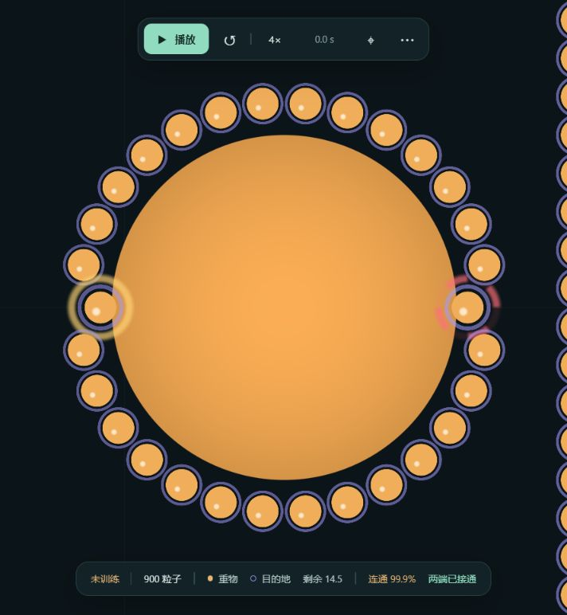

# Issue #4 — v3 本机接续与补充发布验收

2026-10-24，Windows 11。入口 `f8b0d10f97afe32768bac60c052e448e868dbf7b`，包含原 relay 发布及三条视觉补充。本报告只计本轮 v3；不使用旧 v2/4096 的通过结果。

**工程增量闭环通过。RL 未证明学会完整搜索搬运。** 已修复真实 CUDA/运动 relay 与硬件 WGSL 问题，完成三条有明确因果目的的短训练/机制比较；冻结评价结果及完整分母见下方 JSON。失败检查点与轨迹全部保留，没有以发现、消息到达或短时位移冒充成功。

## 现场及边界

- 既有 `.venv`：Python 3.12.10、Torch 2.14.1+cu130、CUDA 13.0、RTX 5060 Laptop 8GB、sm_120、驱动 596.13、Torch threads=2。详见 [system.json](system.json)。该文件记录的是本轮开始的发布 HEAD/dirty 状态，最终代码提交以 Git 历史及交付 identity 为准。
- 开始时 GPU 无训练；仅有别的网络项目的 sticky_failover 进程。未停止/修改它，也未动原 NPA 蜥蜴、AUV 或旧 Swarm。新 Viewer 和训练均属于本仓库。
- 900 粒子、2 个训练环境、未知货物及目的地、1200 控制步、直接 search，无课程；默认物理 dt=.1、8 子步、真实重物阻力12，没有轻物预热、角色、动作保护、自动重连或删除离群粒子。
- 模型 schema=3。第一条训练从零；另两条明确 warmstart 自这条 v3-20 模型，重置优化器、环境和计数。未加载任何 v2 权重。布局 seed 不是独立训练 seed。
- 未运行 Linux CI、Actions、旧 4096、旧耐久/验收矩阵。无独立训练种子或 1000–1002 保留布局测试，因为尚无完整成功。

## 真问题、修复及增量验证

1. 发布的 snapshot 单测遗漏 `SwarmEnv` 导入：原增量 1 fail/26 pass，修复后增量 29 pass。
2. 新 WGSL 真机编译失败：不可变 `let alpha` 后赋值；`fwidth` 位于非一致控制流。改为可变 alpha，并将导数计算提前，保持 uniformity 验证开启和原 WebGPU 后端。[原错误](browser/shader-error-before.txt)。
3. 移动粒子转发旧相对方位时没有扣自身位移：CPU/CUDA 反例均失败，误差约 .05。用各粒子自身实际里程计校正旧消息，再沿当前邻边传递；位移随环境检查点保存。没有给 actor 全局坐标或刷新远端货物真值。修复后冻结轨迹中货物附近的静止目的地方位误差约 1e-6。
4. 增加**动作前**消息诊断：货物附近/实际接触者的消息计数和持有比例，避免把全体覆盖率当有效到达；全局真值只用于记录方位误差。训练日志的比例是逐步均值，跨窗口汇总按人数加权，不能把无接触步的零值误当接触者丢消息。
5. 分离消息逐跳与时间衰减：逐跳仍 .97，实验本地时间保留 .997，原默认 .97 仍可重现。配置保存在 checkpoint、严格 resume 禁止覆盖。保留时间不是免费远程跳跃，也不是动作招募。
6. 可选 `contact_credit_mode=marginal`：每物理子步比较实际货物目标距离与“去掉该粒子接触力”的反事实距离；保留其它力、实际阻力和墙面裁剪。仅改变奖励归因，不改变物理、actor 观察或动作。可在相抵接触中区分正负贡献，未知目标/墙阻挡无额外得分；没有重复 work×900。此实验未获成功，**未设为默认或推荐训练方案**。

保留的定向结果（相互有覆盖，不相加成独立测试数）：[incremental-fixed.xml](incremental-fixed.xml) 29 pass；[diagnostics-fixed.xml](diagnostics-fixed.xml) 24 pass；[retention-fixed.xml](retention-fixed.xml) 28 pass；[marginal.xml](marginal.xml) 11 pass，含真实 CUDA eager/capture；[credit-cli-final.xml](credit-cli-final.xml) 6 pass。也保留 [移动反例](moving-before.xml)、[原 snapshot 失败](incremental.xml)、[统计修复前错误](retention.xml)。本地引入的统计错误已修复，没有计成训练更新。

新增奖励选项后，也修复了旧 schema-3 环境状态缺少该字段时的恢复兼容：缺失只代表原 `work` 语义，不允许借缺失字段改成 `marginal`。[兼容回归](v3-compat.xml) 通过；真实 A20 与 C20 检查点都在 CUDA 加载，分别恢复 .97/work 与 .997/marginal，均明确 `source_changed=true`，没有宣称逐位恢复。代码提交：`b948d63`、`d029444`、`5524626`。

## 补充的正交 WebGPU 视觉验收

实际 Chrome WebGPU adapter 是 **AMD RDNA3**，与 Torch 的 NVIDIA CUDA 设备分别记录。新 shader 实际编译并有真实像素，900 实例、28,928 字节快照，仍是单 pass、每粒子32字节、同一 buffer/绑定，无新增后端或 GPU 读回。

真实 v3 **update1** checkpoint 播放完整120模拟秒，用29.9922948墙钟秒，累计 **4.0010276×**；约20次新状态/秒、49次绘制提交/秒，单 pass GPU 时间约 .131ms，无 WebGPU 错误。终局1200步未送达。见 [累计计时](browser/live-status.json)、[浏览器采样](browser/live-samples.json)、[终局画面](browser/overview-running.png)。文件名 running 不代表截屏时仍在播放。

这是对原工作信用配置的一次有界真机播放，**不代表后来实验信用模式的浏览器倍速，也不代表RL成功**。[暖态分项计时](profile-incremental.json) 的原配置推理约14.7–14.9ms/控制步，relay约.89–1.03ms；分项插入同步，不能相加当生产吞吐。

留档限制：Viewer 当时载入 A更新1（SHA `6476aaa6b0d3fb063e9fe2bbf4316f7f624c1a5748219201b8c81dc83a929044`），同路径 `last.pt` 后续被训练推进到A20；未另存这一更新1的PT。其已载入模型的身份、计时、浏览器采样及终局快照仍保留。不能把当前A20权重称为这次速度模型，或承诺从其复现相同动作轨迹。研究用A20、干预初始、B20、C候选/C20及每次冻结评价权重均已保存。

针对补充语义另用合成几何，运行真实65次逐跳消息及真实瞬时弹簧接触字段。未运行动作、奖励或优化。所有900粒子同时有两端消息：琥珀内核＋紫色独立外环，不存在第三种 both 颜色；正向连续金色/反向断续珊瑚光晕可叠加；白点为直接感知；离群粒子仍存在、透明度降低。选中数值与包体一致：粒子15 force=+1、粒子0 force=-1、粒子899 flags=0且仍收到消息。见 [原字段](visual-probe/states.json)、[复现脚本](visual-probe/probe.py)。



概览/选中截图：[全局](browser/orthogonal-overview.png)、[正向](browser/positive-selected.png)、[反向](browser/negative-selected.png)、[离群](browser/detached-selected.png)。单粒子接触力颜色不等于群体净力、货物位移或任务成功。

## 机制比较与训练结果

三条线均 seed42、900×2、rollout128/BPTT32/3epoch。各20更新、5120 world steps、4,608,000 agent decisions、4完整训练回合，均0成功。60更新是三条计算支线的总和，**不是最终模型连续60更新**。

| 训练线 | 关系与配置 | 目标消息到接触者 | 平均接触人数 | 窗口平均距离改善之和 | 更新中位秒 | 峰值 allocated |
|---|---|---:|---:|---:|---:|---:|
| A `search-main-seed42` | 从零，保留 .97，lr3e-4 | 3.23% | .522 | -.5843 | 5.842 | 439,853,568 B |
| B `retained-search-seed42` | A20 warmstart，保留 .997，lr1e-3 | 99.89% | 7.094 | -4.7982 | 5.350 | 532,778,496 B |
| C `marginal-search-seed42` | A20 warmstart，保留 .997，边际信用×3，lr3e-4 | 87.20% | .122 | +.00019 | 9.321 | 604,168,192 B |

训练改善是每更新的两环境平均改善相加，不是某条完整轨迹的总行程。B 是消息保留加优化步长的新训练分支，不能把其学习变化全归因保留时间；下面的**零更新同权重**比较才隔离消息时间保留的影响。C 开销高于默认线，不能用原播放4×替它背书。所有配置/血缘/计时/源摘要见 [training-summary.json](training-summary.json)，逐更新日志见 [training](training/)。

| 冻结 seed100 | 成功/请求 | 接触者有目标消息 | 距离改善 | 平均朝目标力 | 最长连续接触 |
|---|---:|---:|---:|---:|---:|
| A20 原保留 | 0/1 | 4.72% | -.2557 | -.03494 | 2.6s |
| A20 同权重，仅保留 .997 | 0/1 | 94.78% | +.3976 | +.05064 | 2.4s |
| B20 | 0/1 | 100% | -.9241 | -.11206 | 14.2s |

这三次均完整1200步超时，错误/删失/中断/未开始均0；初态未知两端且均发现两端，桥均0。消息延长没有瞬时泄漏：前两次接触者首次收到目标消息分别19.2s/18.7s。方位误差约1e-6且对齐约1，支持里程计修复和消息时序有效。B 的目标消息已到却持续反向推动，故停止该线。C 的训练进展约零且接触流失，不能当招募、持续合力或搬运已学会；B/C 的学习率也不同，不能据此认定边际信用单独改善了学习。

单次冻结开发100的比较：[A20](window20-dev100/trajectory-analysis.json)、[零更新保留干预](retention-ablation100/trajectory-analysis.json)、[B20](retained20-dev100/trajectory-analysis.json)。不能跨模型混为成功率估计，也不能将三次 seed100 当独立布局。

## 冻结完整评价与结论

C 的 `candidate.pt` 只按训练窗口的真实有符号距离改善挑选：C更新8，继承A20，训练分数+.0304108；SHA `cd90ba729e9865eb484d7c090ac595d4e1f89e90f33ceda6b7b0380a327e2feb`。在运行100–102和单独对角103之前冻结，没有按评价布局挑 checkpoint。C20最后模型继续保留作为接触流失的失败证据。

最终结果见 [正常100–102](frozen-dev/summary.json)、[对角103](frozen-diagonal/summary.json) 及各自 trajectory-analysis/manifest；完整分母、未知初态、所有1200步动作/位置/货物轨迹和SHA均保留。工程完成评价不能替代研究任务通过。

| 冻结布局 | 成功/请求 | 结果 | 距离改善 | 最大接触人数 | 最长连续接触 | 接触者有目标消息 |
|---|---:|---|---:|---:|---:|---:|
| 100 | 0/1 | 1200步超时 | -.00381 | 1 | .2s | 100% |
| 101 | 0/1 | 1200步超时 | -.01443 | 1 | .4s | 100% |
| 102 | 0/1 | 1200步超时 | +.03902 | 2 | .4s | 60.98% |
| 103 对角 | 0/1 | 1200步超时 | -.01816 | 2 | .6s | 2.70% |

正式候选分母：正常0/3、对角0/1；合计请求4、完成4、成功0、超时4、错误0、删失0、中断0、未开始0。4/4发现两端；全群持续连通回合0/4，严格桥接 **0/3937** 个发现后控制步。对角场景目标消息到货物附近也只有7.31%，因此时间保留改善不能推断为任意布局的信息到达问题已解决。本轮其它模型的3次单布局比较独立列出，不与正式候选混算。

## 大文件、源码身份及复现

Git 跟踪精简 JSON/日志/截图/测试证据；PT/NPZ 依仓库规则保留本机，根目录 `C:\Users\ASUS\research-repos\npa-swarm-transport`。交付包内包含本轮保留下来的 v3 运行、评价权重/轨迹、失败状态及源文件快照。[artifact-index.json](artifact-index.json) 索引8个运行检查点和5组评价；已逐个核对7条完整轨迹与冻结模型的SHA。

| 本机模型 | SHA256 |
|---|---|
| `runs/v3/search-main-seed42/last.pt` | `46e2761cd7ba95117eda47d04658c78caa670e9feb5ff1498462cd7a818bf3a1` |
| `runs/v3/retained-search-seed42/initial.pt` | `4af1252e94ee6e903cfe3e787e74a31e31095fde2701baf6c9bb9fd95aa87685` |
| `runs/v3/retained-search-seed42/last.pt` | `e4b2cd16319add97cb66036c79d099b76ee2a82fdaf6825bbb97b620e902a6be` |
| `runs/v3/marginal-search-seed42/last.pt` | `9cbcae3f5c5c2dcc7291b34478f34bc43c09ad0a9ed304cc61cc70c56b459a27` |

精确源文件包按模型的 `source_sha256` 核对：A `8ab238cc...ef3214` → `runs/v3/source-first.zip`；B `41a42aaa...c46050` → `source-retained.zip`；C `6c8f4429...82321` → `source-marginal.zip`。另保留兼容修复后的 `source-final.zip`；各包摘要见 [source-archives.json](source-archives.json)。最终代码新增可选配置，因此重放旧A时源码整体摘要会不同；不能宣称位级恢复，模型权重/保留参数/环境配置则明确记录。

```powershell
# 可选边际信用实验；仅作复现，本轮失败，不建议机械追加
.\.venv\Scripts\python.exe -m npa_swarm train --device cuda:0 --envs 2 --relay-memory-decay .997 --contact-credit-mode marginal --work-credit-weight 3 --warmstart runs/v3/search-main-seed42/last.pt --updates 20 --output runs/v3/new-explicit-run
# 已冻结候选的正式环境评价；输出目录必须为空
.\.venv\Scripts\python.exe -m npa_swarm evaluate --device cuda:0 --checkpoint runs/v3/marginal-search-seed42/candidate.pt --stochastic --seeds 100 101 102 --output reports/new-dev
.\.venv\Scripts\python.exe -m npa_swarm evaluate --device cuda:0 --checkpoint runs/v3/marginal-search-seed42/candidate.pt --stochastic --layout diagonal --seeds 103 --output reports/new-diagonal
```

尚未解决的是**消息已知后的任务条件化招募、持续接触和正确方向的局部信用学习**。消息覆盖、GPU/浏览器速度和工程正确性已分别有实证；不能推断延长同一训练就会成功。Issue #4 保持研究未通过状态，不新建接续 Issue，不排程，不留下无进展长训。
